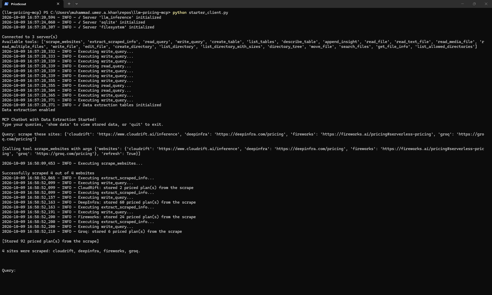
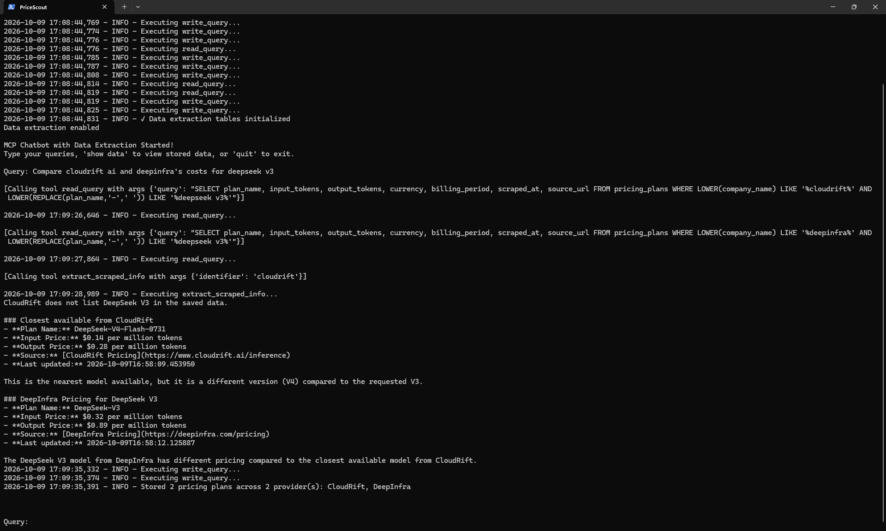
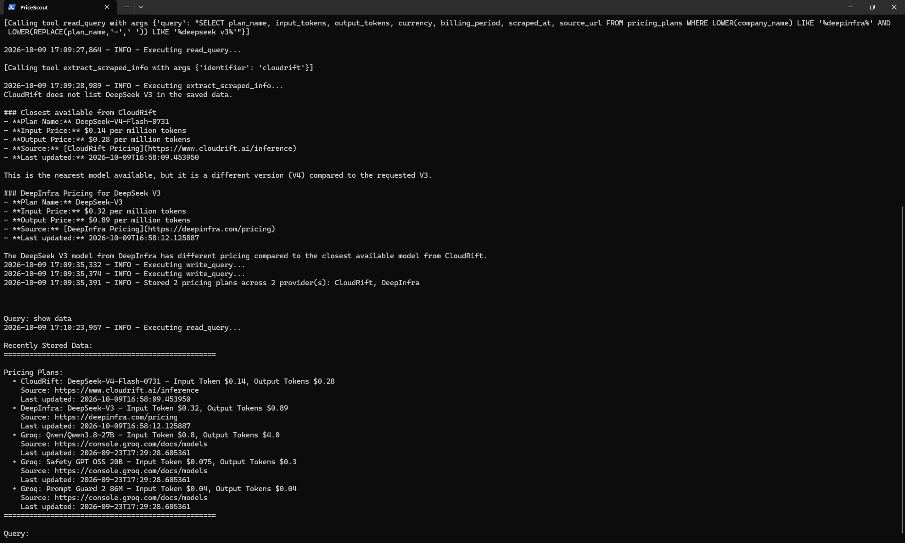

# PriceScout

An MCP-powered chatbot that scrapes LLM inference providers' pricing pages, stores the prices in SQLite, and answers questions such as *"Compare CloudRift AI and DeepInfra's costs for DeepSeek V3"*.

## How it works

| MCP server | Role |
|---|---|
| `llm_inference` (`starter_server.py`) | Scrapes pricing pages with Firecrawl and saves them with `scraped_metadata.json` |
| `sqlite` (`mcp-server-sqlite`) | Stores the extracted plans in `test.db` |
| `filesystem` (`@modelcontextprotocol/server-filesystem`) | Gives the model local file access |

`starter_client.py` connects to all three servers, sends your question to Claude, runs the tools it asks for, and saves the prices it finds.

## Setup

Requires Python 3.10+, [uv](https://docs.astral.sh/uv/) and Node.js.

```bash
uv sync
```

Create a `.env` file:

```
ANTHROPIC_API_KEY=...
FIRECRAWL_API_KEY=fc-...
```

## Usage

```bash
uv run starter_client.py
```

At the `Query:` prompt:

```
scrape these sites: {'cloudrift': 'https://www.cloudrift.ai/inference', 'deepinfra': 'https://deepinfra.com/pricing', 'fireworks': 'https://fireworks.ai/pricing#serverless-pricing', 'groq': 'https://groq.com/pricing'}
Compare cloudrift ai and deepinfra's costs for deepseek v3
show data
quit
```

Follow-up questions are answered from the stored data, so Firecrawl is called only when you ask for a scrape.

## Screenshots

| Scrape | Compare | Stored data |
|---|---|---|
|  |  |  |

## License

[MIT](LICENSE)
